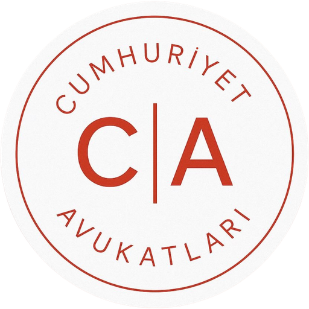

# Kaza Simülatörü — Cumhuriyet Avukatları



Meslektaşlarımızın faydasına, ücretsiz olarak hazırlanmış bir trafik kazası **simülatörüdür**.
Hukuki görüş, bilirkişi raporu veya delil niteliği taşımaz.

Tarayıcıda çalışan, fizik tabanlı trafik kazası canlandırma ve ön analiz aracı.
GateOS In-Browser Micro-App kılavuzuna (`GATEOS-APP-DEV-MANUAL`) göre yeniden yazılmıştır:
Next.js 16 (statik dışa aktarım) · React 19 · strict TypeScript · Tailwind CSS v4 (OKLCH) ·
Radix UI · Lucide · Three.js.

## Özellikler

- **İnternetsiz şablon senaryolar** — ışıklı kavşakta yandan çarpma, DUR levhalı T kavşak,
  kırsal yolda kafa kafaya, duran araca arkadan çarpma, yaya geçidinde yayaya çarpma.
- **Gerçek konum (isteğe bağlı)** — haritadan nokta seçilince OpenStreetMap yol, bina, ağaç,
  ışık/levha verisi alınır; yanıtlar IndexedDB'de önbelleklenir (aynı bölge ikinci kez anında açılır).
- **Fizik motoru** (`lib/simulate.ts`)
  - Çarpışma öncesi: seyir → algılama/tepki → frenleme (µg), şerit ortasından, köşeleri yumuşatılmış güzergâh.
  - Çarpışma: 2B katı cisim itki modeli — doğrusal + açısal momentum korunumu, temas noktası moment kolu,
    çarpma katsayısı, Coulomb temas sürtünmesi. Çarpışma tipi (yandan / kafa kafaya / arkadan / sıyırma)
    ve çarpılan bölgeye göre doğru temas pozu: çarpışma tam işaretlenen noktada olur.
  - Çarpışma sonrası: boyuna/yanal lastik sürtünmesi (sürtünme dairesi), sapma sönümü, ikincil temaslar
    (OBB/SAT), direk/ağaç/bariyer gibi sabit engeller, devrilen iki tekerli.
  - Yaya: Searle fırlatma modeli (sarılma / ileri savrulma), düşme ve kayma.
  - Sonuç 60 kare/sn kare dizisi: zaman çubuğunda ileri-geri sarma anlık ve tutarlı.
- **Raporlama** — fren izinden hız, çarpma hızı, ΔV ve şiddet, duruş mesafesi, algılama noktası,
  **kaçınılabilirlik** (hız sınırında seyretseydi durabilir miydi), Searle ters hesabı, sönümlenen enerji,
  KTK temelli 8'lik dilim kusur ön değerlendirmesi.
- **Görseller** — profil ekstrüzyonlu araç gövdeleri (otomobil, SUV, pikap, panelvan, kamyon, otobüs, TIR,
  motosiklet, bisiklet, traktör), eklemli yürüyen yaya, Türkiye standardında levhalar (DUR, yol ver, ana yol,
  hız sınırı, sollama yasağı, park yasağı, girişi olmayan yol, yaya/okul geçidi, ada etrafında dönünüz),
  kaldırım, bordür, kavşakta kesilen şerit çizgileri, dur çizgileri, zebra, pencereli binalar, lastik izleri,
  enkaz ve çarpışma parlaması.
- **Kameralar** — serbest, kuşbakışı, A/B takip, A/B sürücü gözü (görüş analizi).
- **Çıktılar (tamamen tarayıcıda)** — bilgi katmanlı veya sade fotoğraf (PNG), ölçekli kaza krokisi
  (kuzey oku, ölçek çubuğu, A1/B1 çarpışma konumu, A2/B2 son duruş), video (MP4/WebM, 720p/1080p,
  MediaRecorder), A4 rapor yazdır / PDF.

## Kılavuz uyumu

| Kural | Uygulama |
|---|---|
| Sıfır sunucu yükü | `output: 'export'` — yalnızca statik dosyalar; tüm hesap, çizim, video tarayıcıda. |
| Veritabanı bağımsızlığı | Tercihler yalnızca `localStorage`'da, SHA-256 bütünlük karmalı (`lib/depo.ts`); OSM önbelleği IndexedDB. |
| Sıfır API bağımlılığı | Uygulama şablonlarla internetsiz tam çalışır. Harita/OSM yalnızca kullanıcı konum seçince, doğrudan tarayıcıdan istenir (zorunlu değil, telemetri yok). |
| Taşınabilirlik | 3B motor sahne açılınca yüklenir; sonrasında bağlantı kopsa da çalışmaya devam eder. |
| Güvenlik | `eval`, `new Function`, `dangerouslySetInnerHTML`, dış `<script>`/CDN yok; font npm paketiyle (`@fontsource-variable/montserrat`). Tüm dinleyiciler unmount'ta temizlenir. |
| Görsel kimlik | AHA Red / antrasit / gri OKLCH tokenları, Montserrat, kapsül düğmeler, `rounded-2xl/3xl` kartlar, kırmızı odak halkası. |
| Erişilebilirlik | Space oynat/duraklat · ←/→ 0,1 sn (Shift 1 sn) · Home/End · 1–6 kamera · P panel · F tam ekran · Esc iptal; mobilde panel ve zaman çubuğu kaydırma jestleri. |
| Auth Shield | `<KazaClient isProtected isAuthenticated onRequestLogin />` — oturumsuz kullanıcı önizler, eylemde bordo kilit modalı açılır. |

## Klasör düzeni

```text
src/kaza-simulator/
├── types/kazaTypes.ts        # Tüm tipler
├── data/kazaData.ts          # Yüzeyler, araç türleri, ihlaller, levha kataloğu, şablon senaryolar
├── hooks/
│   ├── useKazaEngine.ts      # Presenter hook: durum, iş mantığı, dışa aktarım, yetki kalkanı
│   ├── useKlavyeKisayollari.ts
│   └── useKaydirma.ts        # Dokunmatik kaydırma
├── lib/                      # Saf motorlar (çizimden bağımsız)
│   ├── simulate.ts  physics.ts  kusur.ts  geometry.ts  senaryo.ts
│   ├── osm.ts  depo.ts  hud.ts  levhaCizim.ts  video.ts
│   └── three/  sahneMotoru.ts  cevreKur.ts  modeller.ts  dokular.ts
├── components/
│   ├── KazaClient.tsx        # Ana istemci arayüzü
│   ├── KazaCard.tsx          # Taraf kartı
│   ├── KazaSettings.tsx      # Koşullar ve çarpışma kurgusu
│   └── …                     # Harita, sahne, palet, sonuç, zaman çubuğu, dışa aktarım, rapor, kilit
└── README.md
```

## Geliştirme

```bash
npm install
npm run dev        # http://localhost:3000
npm test           # fizik/kusur motoru testleri (node:test)
npm run typecheck
npm run build      # out/ — herhangi bir statik barındırıcıya kopyalanabilir
```

GitHub Pages için iş akışı `NEXT_PUBLIC_BASE_PATH=/kaza-simulator` ile derler ve `out/` içeriğini
`gh-pages` dalına yayınlar.

## Yasal uyarı

Kaza Simülatörü, Cumhuriyet Avukatları tarafından meslektaşlarımızın faydasına, trafik kazası dosyalarında
olayın görselleştirilmesi ve ön değerlendirmesine yardımcı olmak amacıyla ücretsiz olarak hazırlanmış bir
simülasyon aracıdır. Ürettiği canlandırma, kroki, hız, mesafe ve kusur dağılımları basitleştirilmiş fizik
modellerine ve kullanıcının girdiği verilere dayanır; **hukuki görüş, bilirkişi raporu, Adli Tıp/ATK veya kusur
raporu niteliği taşımaz**, delil olarak ya da bu raporların yerine kullanılamaz. Somut olayda kusur, hız ve
tazminat değerlendirmesi uzman bilirkişiler ve yetkili yargı mercilerince yapılır. Mevzuat atıfları
örneklendirme amaçlıdır. Uygulamanın kullanımından doğabilecek zararlardan Cumhuriyet Avukatları sorumlu
tutulamaz.

Uyarı, ilk girişte okunup onaylanan pencerede, uygulama altbilgisinde ve tüm çıktılarda (fotoğraf, video,
kroki, A4 rapor) yer alır. Üyelik yok, çerez yok, veri toplanmaz.

Yol verileri © [OpenStreetMap](https://www.openstreetmap.org/copyright) katkıcıları.
